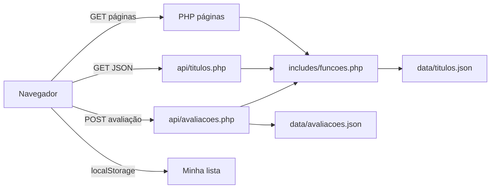

# Documentação do CineGuia

Site de filmes e séries inspirado no IMDb, desenvolvido para apresentação acadêmica.

**Restrição do enunciado:** apenas HTML, CSS, JavaScript e PHP (sem framework, sem banco SQL e sem API externa de filmes).

---

## 1. Objetivo

Criar um catálogo navegável no qual o visitante consiga:

- ver destaques na página inicial;
- buscar e filtrar filmes e séries;
- abrir a ficha de um título (sinopse, elenco, gêneros, semelhantes);
- publicar uma avaliação (nome, nota, comentário);
- guardar uma lista pessoal no próprio navegador.

O foco não é copiar o IMDb inteiro. O foco é **mostrar, com código simples, o caminho dos dados** do arquivo JSON até a tela.

---

## 2. Tecnologias e o papel de cada uma

| Tecnologia | Onde entra | O que o professor pode perguntar |
| --- | --- | --- |
| **HTML** | Estrutura das páginas | Semântica: `header`, `nav`, `main`, `article`, `form` |
| **CSS** | Visual (tema escuro, cartões, layout) | Responsividade com CSS Grid e media queries |
| **JavaScript** | Melhorias no cliente | Lista no `localStorage`, filtros ao vivo, menu mobile |
| **PHP** | Servidor | Ler JSON, filtrar, montar HTML, gravar avaliações, API |

Princípio usado: **melhoria progressiva**. O catálogo funciona só com HTML + PHP (formulário GET). Se o JavaScript estiver ativo, a busca atualiza a grade sem recarregar a página.

---

## 3. Arquitetura



Há dois tipos de persistência de propósito:

1. **Servidor (JSON):** catálogo e avaliações — iguais para todos.
2. **Cliente (`localStorage`):** minha lista — só neste navegador.

Isso é uma decisão didática: dá para explicar sessão vs. arquivo vs. banco sem precisar instalar MySQL no dia da banca.

---

## 4. Estrutura de pastas

```
filme/
├── index.php              Página inicial
├── catalogo.php           Busca e filtros
├── titulo.php             Ficha do título
├── lista.php              Minha lista
├── sobre.php              Resumo na própria interface
├── poster.php             Gera pôster SVG
├── iniciar.bat            Atalho Windows para php -S
├── DOCUMENTACAO.md        Este arquivo
├── README.md              Como executar
├── api/
│   ├── titulos.php        API JSON da busca
│   └── avaliacoes.php     Grava avaliação (POST)
├── includes/
│   ├── funcoes.php        Regras de negócio
│   ├── header.php         Cabeçalho compartilhado
│   ├── footer.php         Rodapé e script
│   └── cartao.php         Cartão reutilizável
├── data/
│   ├── titulos.json       Catálogo
│   └── avaliacoes.json    Avaliações dos usuários
└── assets/
    ├── css/estilo.css
    └── js/app.js
```

---

## 5. Modelo dos dados

Cada item de `titulos.json` segue este formato:

```json
{
  "id": "interestelar",
  "titulo": "Interestelar",
  "tipo": "filme",
  "ano": 2014,
  "duracao": "169 min",
  "classificacao": "12",
  "generos": ["Ficção científica", "Drama"],
  "nota": 8.7,
  "votos": 2100000,
  "diretor": "Christopher Nolan",
  "elenco": ["Matthew McConaughey", "Anne Hathaway"],
  "sinopse": "...",
  "cor": "#1b3a4b"
}
```

- `id` é um slug: aparece na URL (`titulo.php?id=interestelar`).
- `tipo` vale `filme` ou `serie`.
- `nota` e `votos` são a **nota editorial** (fictícia/didática).
- `cor` pinta o pôster SVG e o fundo da ficha.

As avaliações de usuários ficam em `avaliacoes.json`, agrupadas pelo `id`:

```json
{
  "interestelar": [
    {
      "nome": "Ana",
      "nota": 9,
      "comentario": "Visualmente incrível.",
      "data": "2026-10-13 18:00:00"
    }
  ]
}
```

---

## 6. Funcionalidades (casos de uso)

| Caso de uso | Como acontece no código |
| --- | --- |
| Abrir o site | `index.php` chama `titulosEmDestaque()` e monta seções |
| Buscar um título | `catalogo.php` lê `$_GET` e chama `filtrarTitulos()` |
| Filtrar por gênero | O mesmo filtro, parâmetro `genero` |
| Ver ficha | `titulo.php?id=...` + `buscarTituloPorId()` |
| Ver semelhantes | `titulosSimilares()` conta gêneros em comum |
| Avaliar | POST em `api/avaliacoes.php` → `salvarAvaliacao()` |
| Guardar na lista | JavaScript grava o `id` no `localStorage` |
| Ver a lista | `lista.php` injeta o catálogo em JSON; o JS cruza com os ids salvos |

Validações da avaliação (PHP):

- título precisa existir;
- nome com pelo menos 2 caracteres;
- nota inteira de 1 a 10;
- comentário com pelo menos 8 caracteres;
- texto passa por `sanitizarTexto()` e é impresso com `e()` (`htmlspecialchars`) para evitar XSS.

---

## 7. Front-end

### CSS

- Paleta escura e amarelo `#f5c518`, referência visual ao IMDb.
- Grid para os cartões: 4 colunas no desktop, 2 no tablet, 1 no celular.
- Cabeçalho fixo (`position: sticky`).
- Formulários e alertas de sucesso/erro na ficha.

### JavaScript (`assets/js/app.js`)

Três responsabilidades, isoladas em funções:

1. **Menu** em telas estreitas (`aria-expanded`).
2. **Minha lista:** `cineguia-lista` no `localStorage`.
3. **Catálogo ao vivo:** `fetch('api/titulos.php?...')`, redesenha os cartões e atualiza a URL com `history.replaceState` (o usuário pode copiar o link filtrado).

Se o `fetch` falhar, o código devolve o envio tradicional do formulário.

---

## 8. Back-end PHP

Toda regra de negócio está em `includes/funcoes.php`. As páginas não leem JSON direto: isso facilita explicar **separação de responsabilidades**.

Funções principais:

- `carregarTitulos()`
- `buscarTituloPorId()`
- `filtrarTitulos()`
- `titulosSimilares()`
- `salvarAvaliacao()` / `carregarAvaliacoes()`
- `e()` — escape para HTML

`poster.php` devolve `image/svg+xml`. Não há pasta de imagens: o pôster é gerado com o título, o ano e a cor do JSON. Útil se a apresentação estiver sem internet (exceto a fonte do Google Fonts).

---

## 9. Como executar na apresentação

1. Preferência: XAMPP → pasta em `htdocs\filme` → Apache ligado → `http://localhost/filme/index.php`.
2. Alternativa: `iniciar.bat` (exige PHP no PATH).
3. Teste rápido de gravação: abra um título, envie uma avaliação e confira `data/avaliacoes.json`.

Se a avaliação não gravar, o Apache/PHP não está conseguindo escrever na pasta `data/`.

---

## 10. Roteiro sugerido (cerca de 8 a 10 minutos)

1. **Problema (30 s):** “Queremos um IMDb simples para a disciplina, só com as quatro linguagens exigidas.”
2. **Arquitetura (1 min):** mostrar o diagrama da seção 3 e a pasta `data/`.
3. **Home (1 min):** destaque, seções Filmes e Séries — HTML gerado pelo PHP.
4. **Catálogo (2 min):** buscar “Nolan”, filtrar Série + Drama. Mostrar a aba Rede (`api/titulos.php`) se der tempo.
5. **Ficha (2 min):** sinopse, gêneros clicáveis, semelhantes, publicar avaliação.
6. **Minha lista (1 min):** salvar dois títulos, abrir `lista.php`, explicar `localStorage`.
7. **Código (1 min):** `filtrarTitulos()` e o `fetch` no `app.js`.
8. **Limitações e melhorias (1 min):** ver seção 11.

---

## 11. Limitações e melhorias futuras

O que **não** foi feito de propósito:

- login / senha;
- MySQL ou outro SGBD;
- integração com IMDb, TMDB ou OMDb;
- player de trailer;
- upload de pôster real (direitos autorais).

Melhorias naturais se a disciplina avançar:

- tabela `titulos` e `avaliacoes` no MySQL;
- sessão PHP para um usuário autenticado;
- paginação do catálogo;
- testes automatizados das funções de filtro.

---

## 12. Créditos e honestidade acadêmica

As sinopses e notas são **material didático**, não uma cópia oficial do IMDb. O visual apenas se inspira na paleta e na organização (pôster + nota + ficha).

Autor do projeto: estudante responsável pela disciplina. Data de referência: outubro de 2026.
